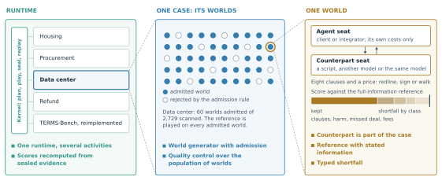
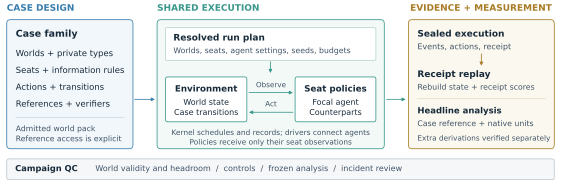

## Abstract

AI agents are increasingly asked to make economic decisions for a principal, such as whom to trade with, what to verify and when to commit. Here a completed transaction can destroy value and a refusal can be correct, so task-completion or agreement scores cannot tell whether an agent served its principal. We present AERead, an environment that scores these decisions by the value an agent obtains. Each case defines a distribution of economic worlds, seats with private information, counterparts with their own interests, and a reference policy whose access to information is stated, so that a shortfall separates poor decisions from information the agent never had. One runtime executes every case and recomputes each score from the sealed record without a model; quality control runs over populations of worlds, not single tasks. We build cases in housing, procurement, data-center contracting and refunds on this runtime. The counterpart is part of the measurement: one agent’s earnings lead over another is \$190k a world head to head and \$26k against the same scripted counterpart. Shortfalls are broken down by stratum and by action class; in housing, nearly all of the gap to the reference falls in worlds where the tenant’s favourite listing is a lemon. Of 25 defects selected from our quality-control record, 14 were invisible in any one world. No case yet passes every quality-control gate, so the results compare named agents on stated worlds rather than rank models. AERead’s code is open source: a new case supplies its economic rules, worlds and reference, and inherits the runtime, replay and the quality-control standard.

## 1. Introduction

An agent buying on behalf of a firm must decide more than whether it can place an order. It must choose whom to trust, whether another test is worth its cost, and when to commit before an offer expires. A tenant faces the same problem when inspecting a home; a negotiator faces it when exchanging price for contractual risk. In these settings, completing a transaction can destroy value, while refusing it can be the right decision. We use *economic-agent readiness* to mean an agent’s ability to obtain value for a principal within a stated mandate, given limited information and other parties’ interests.

Evaluating this ability requires a reference for what the agent could have achieved. A good realized outcome can follow a poor decision, and a shortfall from a fully informed optimum can reflect information the agent never had. The counterpart also matters: a strategy that succeeds against a cooperative seller may fail against a different policy. Existing work provides interactive task evaluation and economic decision benchmarks (Merrill et al. 2026; Fish et al. 2025; Zhang et al. 2026). The problem we address is how to make information, counterpart behavior and reference values explicit across different economic cases, then test whether the resulting scores measure the intended decisions.

AERead provides a framework for constructing and evaluating such cases. Each case specifies the parties, their observations and legal actions, the world distribution, and checks on behavior and outcomes. A shared runtime executes play and records evidence. Case-specific references give scores an economic interpretation: a feasible policy, an optimal policy under the deciding seat’s information, or a labelled full-information upper bound. Results retain their native units and reference types.

<figure id="fig:case" class="case-figure">

<figcaption><strong>Figure 1.1. The three levels of an AERead evaluation,</strong> with the Data-center agreement as the example. The runtime hosts several case families (left). A case draws a population of worlds and admits those where the decision matters; quality control runs over that population (centre). In one world, the agent holds a seat, a counterpart holds another, and the score is compared with the case reference and split into shortfall classes (right). Dashed lines mean "contains", not a sequence. Each panel lists the properties of Section 1 that belong to its level. The dot pattern and the score bar are schematic.</figcaption>
</figure>

AERead combines seven properties. Prior benchmarks have some of them, TERMS-Bench five in full; AERead has six in full and the seventh, a shortcut-screening admission rule, in two of its cases (Table 2.1). The first three concern a single world, the next two a case’s population of worlds, and the last two the runtime (Figure 1.1). Each is built and was applied to the cases reported here.

1.  **Value against a reference with stated information.** Scores are economic values in each case’s own units, measured against a feasible policy, the best policy given the deciding seat’s information, or a labelled full-information bound. Each reference is played through the environment on every admitted world (Section <a href="#sec:qc" data-reference="sec:qc" data-reference-type="ref">6</a>).

2.  **The counterpart is part of the case.** Other parties are seats with their own information and interests, played by scripted policies, another model or the same model, and each claim names its counterpart. In the Data-center case, one agent’s earnings lead over another is \$190k a world head to head and \$26k against a fixed scripted counterpart (Section <a href="#sec:cases" data-reference="sec:cases" data-reference-type="ref">5</a>).

3.  **Typed shortfall.** The gap to the reference is split into observed action classes, such as tests not taken, worse terms, harmful agreements and negotiation fees, so a result states where value was lost as well as how much (Section <a href="#sec:cases" data-reference="sec:cases" data-reference-type="ref">5</a>).

4.  **World generators with admission.** A case is a generator of worlds, and its packs regenerate from their seeds. An admission rule, computed before any agent plays, keeps only worlds in which simple shortcuts lose a stated margin: the Data-center comparison used 60 worlds admitted from 2,729 scanned, and Procurement’s second pack uses the same kind of screen. Housing admits on a structural condition, and the reported Procurement pack had no shortcut screen (Appendix E.2).

5.  **Quality control over populations of worlds.** Cases are qualified through typed gates; simple-rule ceilings are scored beside the agents and briefs are audited. Of 25 defects selected from our record, 14 were invisible in any single world (Section <a href="#sec:qc" data-reference="sec:qc" data-reference-type="ref">6</a>).

6.  **Scores recomputed from sealed evidence.** The kernel hashes a plan before execution, seals the events, and replays each receipt to recompute its scores without calling a model; no model judges a score (Section <a href="#sec:runtime" data-reference="sec:runtime" data-reference-type="ref">4</a>).

7.  **One runtime for several activities.** Families supply only the economic rules. Four maintainer-built cases and a reimplementation of three TERMS-Bench counterpart families run on the same kernel (Section 5.3).

A researcher studying another economic decision therefore writes only its rules, worlds and reference: execution, sealing, replay, counterpart seats and the quality-control gates come with the runtime, so a new case starts with the same evidence and checks as the existing ones. Sections 3 and 4 describe the case design and the runtime, Section 5 the cases, and Section 6 the quality control. The cases are maintainer-built worked examples and none yet passes every qualification gate; Section 7 states what their results do and do not establish.

## 2. Related work

Table 2.1 compares the closest benchmarks on the seven properties of Section <a href="#sec:introduction" data-reference="sec:introduction" data-reference-type="ref">1</a>; the paragraphs below discuss them by theme.

**Table 2.1. The seven properties in related benchmarks,** read from each paper's description of its own method:  present,  partly present, – absent. Each cell was read against a written definition, and the lower mark was chosen where a reading was borderline; page references for every cell are kept with the source. AERead's row describes the cases reported here, none of which yet passes every qualification gate (Section 6). TERMS-Bench has five of the seven properties in full. AERead adds several activities on one runtime and, in two of its cases, an admission rule that screens shortcuts.

| Benchmark | 1\. Value against a reference with stated information | 2\. Counterpart is part of the case | 3\. Typed shortfall | 4\. World generator with admission | 5\. Quality control over populations of worlds | 6\. Scores recomputed from sealed evidence | 7\. Several economic activities on one runtime |
|----|----|----|----|----|----|----|----|
| Terminal-Bench | – | – |  |  |  |  |  |
| τ²-bench | – |  |  |  |  |  |  |
| GDPval | – | – |  | – |  | – |  |
| Agents' Last Exam | – | – |  |  |  |  |  |
| EconEvals |  | – |  |  |  |  |  |
| NegotiationArena |  |  |  | – | – |  |  |
| AgenticPay |  |  |  | – | – |  |  |
| TERMS-Bench |  |  |  |  |  |  |  |
| **AERead (this paper)** |  |  |  |  |  |  |  |

#### Economically valuable work.

GDPval selects professional tasks by occupation and evaluates deliverables through expert comparison (Patwardhan et al. 2025). Agents’ Last Exam (ALE) evaluates expert-authored professional workflows with task-specific verification (Sun et al. 2026). AERead evaluates decisions under a principal’s mandate, with responsive counterparts and payoff references that specify the deciding party’s information.

#### Interactive agent evaluation.

Terminal-Bench verifies final environment state and supplies human-written solutions (Merrill et al. 2026). AppWorld combines an application engine with state-based evaluation, including collateral-change checks (Trivedi et al. 2024). τ²-bench lets agent and user act on shared state (Barres et al. 2025).

#### Economic decisions and negotiation.

EconEvals covers procurement, scheduling, pricing and economic choice (Fish et al. 2025). NegotiationArena studies bargaining tactics (Bianchi et al. 2024); SidConArena combines negotiation, production and auctions (Feng, Chen, and He 2026). AgenticPay evaluates buyer–seller bargaining under private reservation values, scoring agreement, surplus allocation and speed (Liu, Gu, and Song 2026). TERMS-Bench specifies counterpart types, policies and payoffs to diagnose negotiation through oracle-reference gaps (Zhang et al. 2026); our case specifications follow its decomposition into environment, protocol and counterpart policy (Appendix A), and Section 5.3 reimplements three of its counterpart families on AERead’s runtime. AERead retains case-specific payoff units and distinguishes full-information bounds from information-constrained policy references, with QC of world distributions and measurement paths.

#### Shared environments and evaluation quality.

OpenSpiel and PettingZoo provide common interfaces for games and multi-agent environments (Lanctot et al. 2019; Terry et al. 2021). AERead similarly separates shared execution from case semantics (Appendix H). Terminal-Bench combines executable reference solutions, automated checks, human review and adversarial exploit testing (Merrill et al. 2026). The Agentic Benchmark Checklist identifies task and reward defects that distort performance (Zhu et al. 2025). Our QC analysis tests whether prompts, controls and counterpart assignments support valid comparisons across distributions of economic worlds.

## 3. Task design and construction

Three of AERead’s properties are fixed when a case is designed: the reference and the information it may use, the counterpart seats, and the world generator with its admission rule.

### 3.1 Cases, worlds and seats

A *case* defines an economic decision problem; a *world* is one instance of that design, with particular valuations, private types, costs and deadlines. A *seat* is a party’s position in the interaction, with its own objective, information and permitted actions. A policy occupies a seat and chooses actions from its observations and available history. The family implementation supplies the environment, observation rules, legal actions, transitions and verifier.

For example, Housing places a tenant among four listings with hidden quality. The tenant can inspect, make offers and decide whether to sign; landlord replies and outside demand affect the opportunities that remain. Inspection changes both information and cost. The verifier therefore needs to distinguish a legal action, a favorable realized outcome and a good decision given the tenant’s information.

In a controlled comparison, the evaluated policy occupies one seat and counterparts follow fixed policies. Cross-play and self-play change those assignments and answer different questions. Each comparison names the seat, counterpart configuration and world distribution to which it applies. Appendices A–D give the case specifications, counterpart policies, references and measures.

### 3.2 Selecting economic decisions

We organize coverage around activities in which a party’s choices affect the value of a transaction (Li 2026). A candidate case needs a consequential decision, a counterpart with its own interests and information, and an outcome that can be evaluated inside the world. The intended coverage spans business purchases, labour contracts, capital and corporate transactions, household purchases, and public purchases. Contractual terms, risk allocation and disputes enter as decisions within these transactions.

The four examples cover business and household purchases. They were selected to exercise different references and counterpart configurations; they are not a representative sample of economic activity. Economic stakes motivate which decisions to study, but the reported scores are case-specific quantities, without a cross-family aggregate or an estimate of economy-wide gains.

### 3.3 Constructing and qualifying a case

A contribution begins with a decision and an interpretation of success. The author specifies the principal’s objective and constraints, what each seat can observe, which actions commit resources, and how counterpart policies respond. The brief must expose the rules needed to make the decision while preserving the intended private information. These choices define the mechanism that a score is meant to test.

The author then provides a world generator or fixed pack, an admission rule, and a reference whose information access is explicit. Admission screens each candidate world before any agent plays and before hidden types are drawn. Computing exactly from the public world and the declared prior, it keeps a world only if simple shortcuts, such as accepting the default terms or ignoring private information, fall short of the reference by a stated margin. Whether the reference can be reached is a separate check: executable controls play it through the actual environment and verifier on every admitted world, alongside simple policies that reveal shortcuts or ceiling effects that admission missed. The pack must also be valid, free of duplicates, and split into disjoint development and holdout ranges. A full-information bound is labelled separately from a policy the evaluated seat could execute. The case declares score units, direction and treatment of invalid actions and incomplete episodes.

Before a confirmatory comparison, the campaign freezes the worlds, seat assignments, prompts, agent settings, budgets and analysis. Its evidence package should connect each reported measure to the retained actions and outcomes, the scoring implementation, and a command that reproduces it. Section 4 describes the shared execution path; Appendix H records where the current drivers and headline analyses extend beyond the receipt’s coverage.

This is the contribution and qualification standard. Implementation support and completed checks vary across the four examples, as Section 6 and Appendix F document. Cases can be useful for development before qualification, provided their reports identify missing checks, preserve failed attempts, and distinguish analyses declared before execution from later corrections. The current examples demonstrate the workflow and its failure modes; they do not establish successful adoption by external contributors.

## 4. Shared runtime and evaluation harness

The runtime provides two of AERead’s properties: one kernel executes every family, and every score is recomputed by code from sealed evidence. The shared runtime, or *kernel*, executes the case designs in Section <a href="#sec:task-design" data-reference="sec:task-design" data-reference-type="ref">3</a>. Families supply the economic rules; the kernel schedules play and records the evidence used for evaluation (Figure <a href="#fig:architecture" data-reference="fig:architecture" data-reference-type="ref">4.1</a>).

<figure id="fig:architecture" class="architecture-figure">

<figcaption><strong>Figure 4.1. AERead architecture.</strong> Families define the economic world and reference; the runtime coordinates seat policies and retains execution evidence. Agents receive only their seat observations, while scoring uses explicitly declared reference access. Replay checks receipt consistency; separate headline derivations require their own verification. Applied coverage and QC verdicts vary by campaign (Appendices F and H).</figcaption>
</figure>

### 4.1 Verification

Checks compare behavior or outcomes against five kinds of reference: an *answer key* specifies a correct resolution; a *rule* specifies a constraint; *value* measures economic outcomes against a policy or bound; *relative* compares named agents or populations; and a *rubric* rates an artifact. Each check states its output (pass/fail, count or amount) and whether it concerns the outcome or the path. Results retain their native units, without a cross-family aggregate. Value references distinguish a reachable policy, the best policy given the decider’s information, and a full-information upper bound; the last need not be attainable by the evaluated seat.

The case-study scores are computed by code. Kernel replay reconstructs state and each receipt’s score from recorded actions without calling a model. Housing and Procurement also report separately verified headline measures computed outside that receipt certificate; their measurement paths are documented in Appendix <a href="#app:runtime-cases" data-reference="app:runtime-cases" data-reference-type="ref">H.3</a>. Replay establishes consistency with recorded execution. Scientific qualification depends on the checks in Section <a href="#sec:qc" data-reference="sec:qc" data-reference-type="ref">6</a>; none of the four current designs fully passes Gates 1–5 in the review snapshot.

### 4.2 Evaluation harness

Before execution, the kernel hashes a plan declaring worlds, seat assignments, agent configurations, seeds and budgets. During simultaneous play, it freezes all acting seats’ observations before requesting actions and then applies their joint transition. Calls through its provider and tool interfaces are logged with typed outcomes. Finalization seals the evidence and produces a receipt binding the plan, world and scores.

A seat is played in one of three ways. Most models run through AERead’s own harness: each action is a single call through a pinned provider route, with the seat’s instructions and its current observation in and one action in the case’s schema out, no tools, and no memory beyond what the observation shows. The route is checked against its pin, a seed is requested, and the reasoning setting and output limit are declared. Gemini 3.8 Flash, GLM 5.3 Flash and GPT-6 Luna in Housing (Gemini and Luna in Procurement), the Refund models and the TERMS-Bench agents are run this way. The two frontier agents, Opus 5.5 and Sol 6.1, run instead through their vendors’ command-line tools, Claude Code and Codex: one fresh process per action at low effort, with the same instructions and schema, tools disabled or refused, and no session carried over. Neither tool was fully isolated from the operator’s machine (Table <a href="#tab:cli-controls" data-reference="tab:cli-controls" data-reference-type="ref">H.1</a>): Claude Code ran in safe mode, with none of the operator’s instructions, memory or skills but with its working directory in context, and Codex still listed eight of the operator’s own skills. Only the tool’s version and binary are checked, and the tool exposes no seed, temperature or output limit. Through the harness the subject is the model; through a command-line tool it is the product, including its own instructions and internal turns. A comparison across the two paths therefore compares agent configurations rather than models, and each result names its path. Counterparts, references and simple-rule baselines are scripted, call no model and replay exactly. A recorded declaration does not establish that a provider honoured it; Appendix <a href="#app:runtime" data-reference="app:runtime" data-reference-type="ref">H</a> gives the controls each path applied and the versions behind each reported panel.

## 5. Case studies

We present four cases built by the maintainers (Table 5.1). They are worked examples of the framework rather than a fixed benchmark: each is a starting point for questions about the decision it models, and Section 7.2 lists the questions we consider open. The cases show how the counterpart changes measured value and how a shortfall splits into typed action classes; Section 5.3 runs an external benchmark on the same runtime. Housing, Procurement and Data center are described here and specified in Appendices A–D; Refund appears only in the cross-case comparison. Each case is a family rather than a fixed task set: a generator of worlds, a case-specific reference (a policy that uses only what the deciding side may know, or an explicitly labelled full-information upper bound), an admission rule that keeps worlds where the decision matters (its form varies by case; Appendix E.2), and a set of verifiers. The references differ in what a shortfall means: against a reachable policy it is value a feasible strategy would have kept; against the best policy given the decider's information it is the whole cost of the decisions; against a full-information bound it also includes the value of information no seat had (Appendix C).

Cases are chosen by the economic value of the decision, not by occupation (Li 2026): an activity qualifies when its value is decided rather than produced, a counterparty has its own interest and private information, and the result can be scored inside a world against a computed reference. The four examples sit in two of the five transaction classes introduced in §3 (business and household purchases); they were chosen to span the kinds of verifier and counterpart, not sampled from a representative distribution.

**Table 5.1. The four cases. Each is scored in its own units against the reference in the last column.**

| Case | Real setting | What the agent decides | Who it faces | Scored against |
|----|----|----|----|----|
| Housing | informal rental listings | which listing to inspect, what to offer, and whether to sign when some listings are lemons | scripted landlords; other tenants take listings it leaves | a scripted tenant that uses only what the tenant knows |
| Procurement | wholesale sourcing | pay more for an established supplier, or test a cheaper newcomer, before a deadline | scripted suppliers | the best plan given what the buyer knows, solved exactly |
| Data center | AI-infrastructure contracting | which risk clauses to change, what price to name, and when to sign or walk away | the other side: a script, another model or the same model | the best agreement at both sides' true costs, which neither side knows |
| Refund | customer refund claims | what to ask, decide and pay on a claim under a written policy | the other parties to the claim, scripted | a hand-written correct resolution |

How much room each case leaves is reported in its own units: Tables 5.2 to 5.4 give each subject's gap to the reference, and Figure 5.1 splits it by action class. The cases use four of the kinds of check defined with the runner's measurement layer (§4): an answer key, declared rules, the value of the best policy or a bound, and relative standing against another agent; none uses a rubric. Every score is computed by code, with no model in the loop; the kernel's replay recomputes each receipt's own score from its sealed events, while the headline measures of Housing and Procurement are computed by case code outside that certificate (Appendix F.2). Table E.1 lists every check.

### 5.1 Results

Each case's gate status (§6) bounds what its results can claim. The Data-center confirmatory is partial at every gate, chiefly because the client seat has almost nothing to infer and the best informed policy turn by turn is not built; Housing v14 is partial throughout; the Procurement pack reported here fails Gates 1 and 3; and Refund V2.5 fails Gate 3. "Declared" below describes how a comparison was run, with its analysis committed before any cell, not the case: the results compare the named subjects on these worlds and are not qualified benchmark scores.

**Housing.** The structure follows informal rental markets on social platforms such as RedNote: listings are posted with photos a tenant cannot check before viewing, a viewing costs time, and good listings are often taken while the tenant decides. Rents, the lemon share and the inspection cost are set by the authors, not drawn from platform data. A tenant chooses among four listings, two of which are lemons. It knows its own value vℓ for each listing if sound, but not which two are lemons; each of the six pairs is equally likely. In each of three rounds it may pay \$25 to inspect one listing, make one offer, and sign or walk from a lease it is offered, while each listing it did not bid on is taken by outside demand with probability ½. Signing listing ℓ at rent x after k inspections pays vℓ − 1,000·𝟙\[ℓ is a lemon\] − x − 25k; signing nothing pays −25k. The hard part is information. A listing worth \$400 more than its ask if sound is worth 400 − ½·1,000 = −\$100 if signed blind at the ask, but ½·400 − 25 = +\$175 if inspected first and signed only when sound; inspecting a second listing takes another round, in which each listing not bid on may be taken. A landlord's reply can reveal a lemon at no cost: every world is played against one landlord kind whose reply to a low offer reveals a lemon and one whose reply does not. A blind signing is scored at its expected value given what the tenant knew, so the score follows the decision rather than the draw. The declared measure conditions on the landlord's reply in only one case; a corrected measure, introduced in this paper, conditions on every informative reply, and Table 5.2 shows both.

**Table 5.2. Housing v14, main pack; dollars per world, 95% intervals over worlds. The corrected block is a post-run reanalysis, reproduced from sealed records on 16 October; the declared measure remains visible.**

|  | Gemini 3.8 Flash | GLM 5.3 Flash | GPT-6 Luna |
|----|---:|---:|---:|
| Complete worlds: all (favourite lemon / sound) | 260 (200 / 60) | 260 (200 / 60) | 260 (200 / 60) |
| *Declared measure, as frozen* |  |  |  |
| Tenant net | +211 \[+189, +233\] | +137 \[+111, +162\] | +130 \[+104, +156\] |
| Minus the reference, favourite is a lemon | −101 \[−120, −82\] | −179 \[−203, −154\] | −207 \[−229, −186\] |
| Minus the reference, favourite is sound | −14 \[−18, −9\] | −76 \[−116, −36\] | −9 \[−16, −2\] |
| Minus a rule that inspects when the odds make it pay, then signs | +66 \[+50, +82\] | −8 \[−30, +14\] | −15 \[−32, +2\] |
| *Corrected measure, reanalysis* |  |  |  |
| Tenant net | +213 \[+191, +235\] | +149 \[+124, +175\] | +147 \[+121, +174\] |
| Minus the reference, favourite is a lemon | −98 \[−117, −80\] | −164 \[−189, −139\] | −185 \[−208, −162\] |
| Minus the reference, favourite is sound | −14 \[−18, −9\] | −70 \[−108, −32\] | −9 \[−16, −2\] |
| Minus a rule that inspects when the odds make it pay, then signs | +68 \[+52, +84\] | +5 \[−17, +27\] | +3 \[−15, +20\] |

Under the analysis declared before any cell (three pairs, Holm; \$50 minimum) Gemini leads GLM by +74 \[+53, +95\] and Luna by +81 \[+63, +98\], and GLM and Luna do not differ (+7 \[−16, +29\]); the 40-world holdout agrees. Under the corrected measure, a reanalysis not declared in advance, the leads are +63 \[+43, +84\] and +65 \[+49, +82\] and GLM minus Luna is +2 \[−20, +24\]: no declared verdict changes, but both lower bounds fall below \$50. None reaches the reference, and almost the whole shortfall is in worlds where the favourite listing is a lemon. The rule in the last row of each block, scored after the runs, earns \$145 a world; under either measure Gemini beats it and GLM and Luna are not distinguishable from it.

**Procurement.** The structure follows wholesale sourcing on B2B platforms such as Alibaba's 1688. In our own sourcing of parts for 231 hardware projects, 1688 search results showed 341 suppliers; 236 requests went to 28 of them and 9 returned quotes, and an exact-variant screen of 51 listings accepted 1, left 20 conditional and rejected 30. A displayed price is not a quote, and a listing's quality is known only after it is checked. Two of the case's assumptions depart from that record by design: its recorded supplier always charges a premium, whereas in the record a seller with a sales history was dearer than one without in only about half of comparable parts; and its quotes always arrive, whereas most requests went unanswered. The case's prices, failure rates and delays are set by the authors, not calibrated to that record. A buyer owes 50 kits by a deadline and awards one supplier: a recorded supplier with a long clean record, or one of three cheaper newcomers. Each newcomer is good, late or poor, and the buyer knows only the odds, read from the record of its seller kind. Among up to ten actions it may request a quote (\$2 and a day, which exposes a late supplier), request a sample (\$30 to \$80 and two or three days, which exposes a poor one), award, or defer. An award that delivers k kits on time earns 37k − 12(50 − k) less the order's cost and the information bought; one that delivers fewer than 40, as a late or poor supplier does, is worth −\$600 less the information bought (Appendix A.2). The hard part is whether information is worth its price and its days. In one world the recorded supplier's award earns \$418 and a newcomer 15% cheaper earns \$628 if good, with odds of 0.45 good, 0.20 late and 0.35 poor; quoting it, then sampling it (\$50) only if the quote is clean, is worth \$65.90 more than paying the premium, provided a failed test leaves time to return to the recorded supplier. Every action is charged what it gave up against the exact best informed policy at that point.

**Table 5.3. Procurement pay-or-test, 24 worlds per subject; dollars given up per world against the best policy, which earns \$451 a world. All 96 losses and these intervals were reproduced on 16 October by a source-pinned derivation from replay-audited sealed actions; decision loss is separate from the original receipt scores.**

|  | Sol 6.1 (Codex) | Opus 5.5 (Claude Code) | Gemini 3.8 Flash | GPT-6 Luna |
|----|---:|---:|---:|---:|
| Given up per world | 1.0 \[0.2, 2.1\] | 5.4 \[1.2, 10.6\] | 75.2 \[48.7, 101.4\] | 74.4 \[46.7, 102.7\] |
| Share of the best policy's value | 99.8% | 98.8% | 83.3% | 83.5% |

The frontier agents (through their CLIs) are at the ceiling; most of what they lost on a first run came from two rules the brief left unsaid, that a quote is final and that the average is the criterion. That ceiling shows less than it seems: on this pack a rule that looks one test ahead comes within \$0.06 a world of the best policy, so near-perfect play shows that the agents avoid the listed mistakes, not that they plan further ahead than one test. A v2 gate and pilot (50 cells, \$0.22) found little newcomer testing and required 326 to 3,464 worlds against a 96-world cap, so no confirmatory run followed (Appendix F.4). The flash models give up what always paying the premium gives up: their loss is in the worlds where a newcomer was worth testing.

**Data center.** The structure follows a real AI-infrastructure engagement in which a system integrator bundles hardware, data-center space, staffing and software into a working system for a client. Hardware can arrive late or defective and the site may not be ready, and the contract's warranty, delay-damages, liability-cap, site-readiness, deposit and burn-in clauses decide who bears each cost. Costs, probabilities and prices are set by the authors. Client and integrator negotiate one agreement: a position on each of the eight clauses (600 distinct agreements) and an all-in price p. Each side knows its own cost of carrying risk and only the odds of the other's: the integrator's pre-staging cost and risk charge, the client's risk charge. Over six alternating moves a side may redline any clauses and name a price, sign the standing version, or walk, and each redline after the first move costs \$25k. A signed agreement c pays the integrator p − CI(c) − 500 and the client OC − p − CC(c), in \$ thousands and less redline fees, where 500 is the integrator's outside option, OC the client's, and CI and CC each side's expected cost of the risks the clauses leave with it, marked up by its risk charge; no deal pays only the fees. The hard part is that price only divides the value while the clauses decide how much there is, and the best clauses depend on what the other side hides. Burn-in, for example, costs the integrator \$40k and, in one world, the client a week's delay worth \$110k, and halves the chance of a \$3 million incident the client carries; it lowers joint cost by \$41k for a client with the highest risk charge and raises it by \$19k or \$64k for the other two, and the integrator cannot tell which client it faces. The comparison declared before its runs used 60 admitted worlds: 45 with a mutually beneficial deal and 15 without one. Table 5.4 reports its three primary contrasts; development results remain in Tables E.3 and E.7.

**Table 5.4. Data-center agreement confirmatory: Sol 6.1 (Codex) and Opus 5.5 (Claude Code). Earnings are \$ thousands above the seat's outside option, at true costs; intervals are 95%, with Holm correction across the three primaries. The campaign has eight documented departures and a partial Gate 5 verdict (Appendix F.5).**

| Primary contrast | Worlds | Estimate \[95% interval\] | Holm p |
|----|---:|----|---:|
| Head to head: Sol minus Opus earnings, seat-averaged | 45 deal | +190.1 \[148.0, 232.1\] | 3.2e-11 |
| Firm population: Sol minus Opus earnings, seat-averaged | 45 deal | +26.4 \[10.5, 42.4\] | 0.0017 |
| Client signs below its walk-away point: Opus / Sol | all 60 | 27/60 vs 3/60 (40 percentage points) | 2.4e-7 |

Sol's lead against the firm population is detectable but smaller than the plan's \$50k minimum: the 98.3% interval is \[6.7, 46.1\]. Head to head the opponent changes with the focal model; the firm-population contrast holds the counterpart policy fixed. The distinction supports a counterpart-specific reading of the larger head-to-head gap. All primary negotiations are valid. Across the pilot and three arms, 1,175 of 1,176 negotiations are valid (\$74.41 list price); one secondary-arm CLI failure remains missing. The client seat still measures pricing and the walk-away decision under nearly complete clause information, because the integrator's private cost barely changes its best agreement.

The two CLIs were not equally isolated from the operator's machine: Codex's context listed eight of the operator's own skills, two described in benchmark and evaluation terms, and Claude Code's listed none (Table H.1). Every Sol-versus-Opus contrast in this paper carries that unmeasured difference; a second confirmatory, declared with both subjects isolated and their context probed before it runs, removes it.

### 5.2 Where the shortfall comes from

Figure 5.1 separates each case's shortfall into observed action classes. The components sum to the total under a stated priority order; they describe what happened, not its cause. Each panel uses its own reference and units. Appendix E.5 gives the rules and full subject tables; E.7 gives the current Data-center breakdown and uncertainty. Table E.10 retains the exact panel values.

<figure id="fig-shortfall" class="shortfall-figure">

<figcaption><strong>Figure 5.1. Shortfall to each case's reference.</strong> Segments account for observed actions; labels give mean totals (lower is better within a panel). Units and scales differ. Housing shows all three models on 260 worlds; GLM's inspection cost of −0.2 a world is in Table E.10 and is not drawn. Procurement shows all four subjects; full subject tables are in Appendix E.5. Data center reports joint loss against the full-information bound with firm counterparts at $25k per paid redline; individual below-walk-away signings are separate (Table 5.4). Intervals and exact values appear in Tables 5.3, E.9 and E.10.</figcaption>
</figure>

Procurement's Gemini loss comes entirely from foregoing useful tests; Housing's Gemini loss is mostly worse lease terms. Luna's largest Housing class is signing at a rent above a lemon's value when the reply identifies a lemon under the landlord policy. The v14 brief omitted that pricing rule, so the label does not establish that the tenant knew how to interpret the reply. In Refund, Gemini 2.5 Flash Lite's loss is chiefly procedure or format.

In Data center, the \$25k redline fee accounts for 69.9% of Sol's and 40.3% of Opus's joint loss against the firm population across all 60 worlds. Fees can accompany valuable contract improvements; their share alone does not establish inefficient negotiation. The full-information reference can agree immediately, so the gap includes costs that agents with limited information may need to incur. Opus also signs harmful agreements in worlds without positive available surplus.

Exploratory replay with actions fixed separates scoring sensitivity from behavioral adaptation (Appendix E.9). On the 45 deal-feasible worlds, Opus retains lower joint loss at zero fees; Sol's earnings lead rises from \$26.4k to \$54.8k and reverses near \$48.3k per redline. Across all 60 worlds, however, removing fees reverses the joint-loss ranking: Sol loses \$31.1k versus Opus's \$42.3k. Fee robustness therefore depends on the measure and the worlds included.

**Across the cases.** Four things hold. The gap sits in a stratum the design fixes in advance, so every case reports by stratum and pools last. The counterpart is part of the measurement, so a claim names the counterparts it covers. What the brief states moves the score as much as the subject does (stating two rules cut procurement loss by \$11 to \$14; stating a walk-away cost cut losing signatures from 15 of 60 to 1 of 60), so the brief is a versioned part of the case. And a pattern found by looking back is a hypothesis until a declared test confirms it.

Housing, Procurement and Data center take their decision structure from real settings (Section 5.1): informal rentals, wholesale sourcing and AI-infrastructure contracting. Their parameters are set by the authors, not calibrated to field data. The experiments use controlled scenarios and a small set of agent configurations, with no human policy baseline; they do not establish general model rankings.

### 5.3 An external benchmark on the same runtime

TERMS-Bench evaluates bilateral price negotiation against counterparts whose type is hidden (Zhang et al. 2026). We reimplemented, from the paper's description, its alternating-offer environment, three of its six counterpart families (Candid, Taciturn and Expressive) and four of its measures as one AERead family. The counterpart runs as a scripted seat, and its random draws are sealed each turn, so replay recomputes the counterpart's moves as well as the scores. Not implemented: the Oracle-Cue reference and the gap measures built on it, the urgency regime, type-belief error and the other three families; counterpart messages are templates. The corpus has 30 cases, 15 with a zone of agreement and 15 without, each played once.

**Table 5.5. TERMS-Bench reimplementation: two of the paper's agents on the same 30 cases, scripted counterpart and settings. Agreement and surplus are over the cases with a zone of agreement: 15 for GPT-4o-mini and 12 for GLM-5.1, whose three malformed moves removed those episodes. Paper values: surplus efficiency from its Table 16 (overlap regime, mean of the three families played here); agreement and conditional surplus efficiency from its Table 2, which pools six families and three regimes.**

|  | GPT-4o-mini | GLM-5.1 | Paper: GPT-4o-mini | Paper: GLM-5.1 |
|----|---:|---:|---:|---:|
| Agreement rate where a deal exists (AGR+) | 0.80 | 1.00 | 0.522 | 0.951 |
| Surplus efficiency (SE+) | 0.035 | 0.458 | 0.196 | 0.668 |
| Conditional surplus efficiency (CSE+) | 0.044 | 0.458 | 0.363 | 0.721 |

The reimplementation orders the two agents as the paper does on all three measures, but absolute levels are lower for both, and for a third model. A review of the port after these runs traced the shift to four departures from the paper's protocol, not to the agent, whose interface in the paper is also one stateless call per round. Our prompt does not state the agent's payoff or the rule against accepting above its reservation value; its observation differs from the paper's; a malformed move removes the episode where the paper applies a fallback, under which GLM-5.1's surplus efficiency would be 0.520 over all 15 cases; and our price range and zone widths are wider than the paper's. A declared reproduction will follow those fixes. The paper reports critical violations by GLM-5.1 in 5% of cases without a zone of agreement for these three families; at that rate 15 such cases would show none about half the time, and ours showed none. The port also exposed a harness effect. On one provider route, any declared reasoning budget suppressed deliberation, and GLM 5.3 Flash breached its own reservation value in 13 of 30 cases against the paper's band of 0 to 2.06%. With no reasoning declaration it breached in 2 of 30 and its surplus efficiency rose from 0.40 to 0.53; the comparison above uses that setting. This is why the reasoning condition is part of each run's declared configuration. The runtime support for a scripted seat that this family uses is still in development.

## 6. Quality control

The defects that mattered in the four cases were properties of the distribution, the brief, the counterpart or the analysis, and every world was individually correct when they were found: a seat-number tie-break that decided who signed the good listing, a prompt that pointed every subject at the right supplier in half the worlds and the wrong one in the other half, a hidden type tied to the pack cell so that comparisons by type compared worlds. Reading one world at a time passes all three. Quality control is therefore organised around populations of worlds, declared analyses and recorded failures. Appendix F describes each check that was applied to these cases, and only those.

**Gates.** A case is qualified in six gates recorded in its family's QC profile: a profile exists (0); the worlds are valid, distinct, split and leave headroom (1); actions change the intended state and every score is rebuilt from sealed evidence (2); a better-informed policy does better and shortcuts lose (3); the result supports the attribution it claims (4); and the comparison was sized, frozen and executed without tuning on outcomes (5). Each gate is typed `passed`, `failed`, `partial`, `not_run` or `not_applicable`, and only `passed` promotes. The profiles followed the initial runs; the agreement confirmatory followed its profile. None of the four passes Gates 1 to 5 yet (Appendix F.1).

**The reference is played on every world.** For each case a test plays the reference through the real environment and verifier on every admitted world, with no model, and checks that it reaches its declared result: the Housing reference and a full-information tenant reproduce the published values in all 600 v14 cells; Procurement's best policy equals the environment's average over its 27 type profiles in all 24 worlds; the data-center oracle pair loses nothing in all 116 worlds of both development packs and all 60 of the admitted confirmatory pack; Refund V2.5's release requires full credit on every case. The initial tests followed development; the admitted-pack dry run preceded the confirmatory; two of them (the data-center grade and the Housing ceiling) are shown to fail when the grade or the reference is wrong.

**Other checks.** Every committed pack is regenerated byte for byte from its seeds; the Housing v14 receipts replay from their sealed events; trivial agents are reported beside the subjects, Procurement's fixed rules are scored exactly, and the briefs were audited for instructions that decide the outcome. Uncertainty is computed over worlds, claims name their counterparts, and three reported analyses were declared before their runs: Housing v14, the data-center signalling test and the agreement confirmatory.

**What it found.** Discovered failures are recorded in an incident log in design, operational, tooling and judgment rows that are never deleted (51, 57, 90 and 23 distinct entries across the project's logs). Of 25 defects selected for Table F.4, 14 were invisible in any single world; the 11 visible ones were found by reading code or sealed bytes, by tracing a case, or in a single gate cell (Table F.4). Nine were open when the table was compiled; a later reanalysis from the sealed actions resolves one of them for the reported panels, leaving eight open. The same checks corrected three of our own statements while this paper was written.

## 7. Discussion and conclusion

### 7.1 What the cases show

AERead evaluates an agent’s economic decisions by the value it obtains for a principal, given the information, resources and authority of its seat. Each score is measured against a reference whose access to information is stated, whether a feasible policy, the best policy under the seat’s information or a full-information bound, and it keeps its own units and names the counterparts it was measured against, so that every shortfall has a defined interpretation. The worked examples apply this to information acquisition, bargaining and commitment in housing, procurement and contracting, and a reimplementation of part of TERMS-Bench runs on the same runtime.

The cases teach three lessons that bear on any evaluation of this kind. The counterpart is part of the measurement: the same two agents differ by far more when they negotiate with each other than when each faces a fixed counterpart. The brief is part of the case: stating a rule it had left implicit moved scores as much as changing the agent did. And the defects that matter are often properties of the population of worlds, the brief or the analysis rather than of any single world, which is why construction and quality control belong in the method; the checks of Section 6 changed the interpretation of our own results. Loss categories locate a shortfall but do not explain it, and explaining it requires controlled follow-up comparisons. Replay establishes consistency with recorded play; construct validity requires evidence about the worlds, the information and the controls.

These properties matter most where agents are deployed. Organizations that pilot agents often stop because the business value is unclear and the risks are hard to control (Gartner 2025); a value score against a stated reference and a typed account of losses address both. Small firms face a different problem: short of staff (National Federation of Independent Business 2026), they often leave decisions like those our cases model to one person, without specialized expertise and with no review before a commitment. Delegating such a decision to an agent is attractive there, and trusting it requires evidence that the agent keeps value against the counterparts it will meet.

The present evidence has clear limits. The cases take their decision structure from informal rentals, wholesale sourcing and AI-infrastructure contracting, but their parameters are set by the authors; calibration to field data and transfer to field settings remain to be established. Coverage is limited to two transaction classes and a small set of agent configurations, with no human policy baseline. No case yet passes every qualification gate: several checks were added after the runs, and hosted-model and CLI behavior limits attribution from declared settings. Versioned reanalyses now regenerate the corrected Housing measures and Procurement decision losses from sealed records, which strengthens their provenance, but full verification against original execution still requires retained logs (Appendix G), and the reanalyses neither qualify the campaigns retroactively nor resolve Housing’s historical seat attribution (Appendix H). The results therefore compare named agents on stated worlds; they do not establish general model rankings or deployment readiness.

### 7.2 Open research directions and contributions

AERead is shared infrastructure for studying how agents make economic decisions. Its code is open source under the Apache-2.0 license (github.com/aeread-org/AERead; contact@aeread.org), and contributors can pursue their own questions with the existing cases, counterparts and evidence. The results above leave four questions open, each suited to a different kind of contribution.

- **Counterpart populations.** The Data-center gap between two agents is \$190k a world head to head and \$26k against a fixed script. How far does an agent’s measured skill depend on whom it faces, can rankings reverse across counterpart populations (none did in our runs), and which populations separate distinct strategic capabilities? The scripted styles, head-to-head pairings and counterpart seats are in place.

- **Validity of populations of worlds.** Of 25 defects selected from our record, 14 were invisible in any single world. Which checks find such defects before a campaign runs, and what should qualify a case? The quality-control gates, the incident record and the failed campaigns are available for study.

- **Information and judgment.** Stating a rule the brief had left implicit moved scores as much as changing the agent. Separating what an agent was told from how it decided, and computing best-informed references for richer cases, are open methodological problems.

- **New economic decisions.** A case for another activity supplies its rules, worlds and reference; execution, replay, counterpart seats and the quality-control standard come with the runtime.

What is ready and what is not: the runtime, its sealed evidence and replay, and the case layout are in use, and Housing, Procurement and Data center each have a world generator, references and scripted counterparts. No case is yet qualified. Section <a href="#sec:qc" data-reference="sec:qc" data-reference-type="ref">6</a> gives every gate verdict and Appendix F each campaign’s open checks, so a contributor can see what a case still needs before its results can rank agents.

The next steps follow from the limits in Section 7.1. Future campaigns should bind actual seat assignments and headline scorers into frozen evaluation identities and run the required controls before any comparison, and the TERMS-Bench reimplementation needs the protocol fixes described in Section 5.3 before a declared reproduction. Practitioner review would calibrate the cases’ parameters, human baselines would show where agents stand against people, and externally contributed cases would test whether the structure serves authors other than its maintainers. AERead’s present contribution is that structure, a common way to construct evaluations of economic decisions, together with an evidence-based account of the checks needed to interpret what they measure.

## References

Barres, Victor, Honghua Dong, Soham Ray, Xujie Si, and Karthik Narasimhan. 2025. “τ²-Bench: Evaluating Conversational Agents in a Dual-Control Environment.” *arXiv Preprint arXiv:2506.07982*. <https://arxiv.org/abs/2506.07982>. Bianchi, Federico, Patrick John Chia, Mert Yuksekgonul, Jacopo Tagliabue, Dan Jurafsky, and James Zou. 2024. “How Well Can LLMs Negotiate? NegotiationArena Platform and Analysis.” *arXiv Preprint arXiv:2402.05863*. <https://arxiv.org/abs/2402.05863>. Feng, Yeqi, Yuxin Chen, and Tianxing He. 2026. “SidConArena: An Environment Evaluating Agents in Open-Ended, Positive-Sum Bargaining Game.” *arXiv Preprint arXiv:2606.27397*. <https://arxiv.org/abs/2606.27397>. Fish, Sara, Julia Shephard, Minkai Li, Ran I. Shorrer, and Yannai A. Gonczarowski. 2025. “EconEvals: Benchmarks and Litmus Tests for Economic Decision-Making by LLM Agents.” *arXiv Preprint arXiv:2503.18825*. <https://arxiv.org/abs/2503.18825>. Gartner. 2025. “Gartner Predicts over 40% of Agentic AI Projects Will Be Canceled by End of 2027.” <https://www.gartner.com/en/newsroom/press-releases/2025-06-25-gartner-predicts-over-40-percent-of-agentic-ai-projects-will-be-canceled-by-end-of-2027>. He, Horace, and Thinking Machines Lab. 2025. “Defeating Nondeterminism in LLM Inference.” <https://thinkingmachines.ai/blog/defeating-nondeterminism-in-llm-inference/>. Lanctot, Marc, Edward Lockhart, Jean-Baptiste Lespiau, Vinicius Zambaldi, Satyaki Upadhyay, Julien Pérolat, Sriram Srinivasan, et al. 2019. “OpenSpiel: A Framework for Reinforcement Learning in Games.” *arXiv Preprint arXiv:1908.09453*. <https://arxiv.org/abs/1908.09453>. Li, Chenyu. 2026. “Activities, Not Occupations.” <https://aeread.org/blog/activities-not-occupations.html>. Liu, Xianyang, Shangding Gu, and Dawn Song. 2026. “AgenticPay: A Multi-Agent LLM Negotiation System for Buyer-Seller Transactions.” *arXiv Preprint arXiv:2602.06008*. <https://arxiv.org/abs/2602.06008>. Merrill, Mike A., Alexander G. Shaw, Nicholas Carlini, Boxuan Li, Harsh Raj, Ivan Bercovich, et al. 2026. “Terminal-Bench: Benchmarking Agents on Hard, Realistic Tasks in Command Line Interfaces.” *arXiv Preprint arXiv:2601.11868*. <https://arxiv.org/abs/2601.11868>. National Federation of Independent Business. 2026. “NFIB Jobs Report: Small Business Hiring Slows in September.” <https://www.nfib.com/news/press-release/nfib-jobs-report-small-business-hiring-slows-in-september/>. Patwardhan, Tejal, Rachel Dias, Elizabeth Proehl, Grace Kim, Michele Wang, Olivia Watkins, Simón Posada Fishman, et al. 2025. “GDPval: Evaluating AI Model Performance on Real-World Economically Valuable Tasks.” *arXiv Preprint arXiv:2510.04374*. <https://arxiv.org/abs/2510.04374>. Sun, Yiyou, Xinyang Han, Weichen Zhang, Yuanbo Pang, Tianyu Wang, Yuhan Cao, Yixiao Huang, et al. 2026. “Agents’ Last Exam.” *arXiv Preprint arXiv:2606.05405*. <https://arxiv.org/abs/2606.05405>. Terry, J. K., Benjamin Black, Nathaniel Grammel, Mario Jayakumar, Ananth Hari, Ryan Sullivan, Luis S. Santos, et al. 2021. “PettingZoo: Gym for Multi-Agent Reinforcement Learning.” In *Advances in Neural Information Processing Systems*. Vol. 34. <https://arxiv.org/abs/2009.14471>. Trivedi, Harsh, Tushar Khot, Mareike Hartmann, Ruskin Manku, Vinty Dong, Edward Li, Shashank Gupta, Ashish Sabharwal, and Niranjan Balasubramanian. 2024. “AppWorld: A Controllable World of Apps and People for Benchmarking Interactive Coding Agents.” *arXiv Preprint arXiv:2407.18901*. <https://arxiv.org/abs/2407.18901>. Zhang, Erica, Fangzhao Zhang, Aneesh Pappu, Batu El, Jose Blanchet, Susan Athey, Jiashuo Liu, and James Zou. 2026. “TERMS-Bench: Diagnosing LLM Negotiation Agents Beyond Deal Rate.” *arXiv Preprint arXiv:2605.13909*. <https://arxiv.org/abs/2605.13909>. Zhu, Yuxuan et al. 2025. “Establishing Best Practices for Building Rigorous Agentic Benchmarks.” <https://arxiv.org/abs/2507.02825>.
