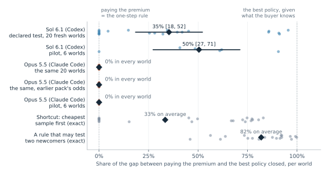
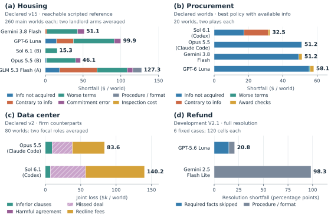

# Case studies (draft section of the AERead environment paper)

**Author:** Chenyu Li. **Status:** working draft, 2026-10-16. The main-text section; case
details are in [Appendix E](paper_appendix_details.md), formal specifications in
[Appendices A–D](paper_appendix_case_specs.md). Six reported analyses were declared before their runs: Housing v14 and v15, Procurement's test on
its harder pack, the data-center signalling test and the two data-center agreement confirmatories.
Other results are development probes; Procurement v2 stopped after its pilot. The companion section is [Quality control](paper_qc_design.md).

---

## 5. Case studies

We present four cases built by the maintainers (Table 5.1). They are worked examples of the
framework rather than a fixed benchmark: each is a starting point for questions about the decision
it models, and Section 7.2 lists the questions we consider open. The cases show how the counterpart changes measured value and how a shortfall
splits into typed action classes; Section 5.3 runs an external benchmark on the same runtime. Housing, Procurement and Data center are described here and specified in Appendices A–D;
Refund appears only in the cross-case comparison. Each case is a family rather than a fixed task
set: a generator of worlds, a case-specific reference (a policy that uses only what the deciding
side may know, or an explicitly labelled full-information upper bound), an admission rule that
keeps worlds where the decision matters (its form varies by case; Appendix E.2), and a set of verifiers. The references differ in
what a shortfall means: against a reachable policy it is value a feasible strategy would have
kept; against the best policy given the decider's information it is the whole cost of the
decisions; against a full-information bound it also includes the value of information no seat
had (Appendix C).

Cases are chosen by the economic value of the decision, not by occupation [AV]: an activity
qualifies when its value is decided rather than produced, a counterparty has its own interest and
private information, and the result can be scored inside a world against a computed reference.
The four examples sit in two of the five transaction classes introduced in §3
(business and household purchases); they were chosen to span the kinds of verifier and
counterpart, not sampled from a representative distribution.

**Table 5.1. The four cases. Each is scored in its own units against the reference in the last column.**

| Case | Real setting | What the agent decides | Who it faces | Scored against |
|---|---|---|---|---|
| Housing | informal rental listings | which listing to inspect, what to offer, and whether to sign when some listings are lemons | scripted landlords; other tenants take listings it leaves | a scripted tenant that uses only what the tenant knows |
| Procurement | wholesale sourcing | pay more for an established supplier, or test a cheaper newcomer, before a deadline | scripted suppliers | the best plan given what the buyer knows, solved exactly |
| Data center | AI-infrastructure contracting | which risk clauses to change, what price to name, and when to sign or walk away | the other side: a script, another model or the same model | the best agreement at both sides' true costs, which neither side knows |
| Refund | customer refund claims | what to ask, decide and pay on a claim under a written policy | the other parties to the claim, scripted | a hand-written correct resolution |

How much room each case leaves is reported as a share of that case's own reference value: Tables 5.2 to 5.4 give each subject's result and gap that way, and Figure 5.2 splits the gap by action class in the case's units. The cases use four of the kinds of check defined with the runner's measurement layer (§4): an
answer key, declared rules, the value of the best policy or a bound, and relative standing
against another agent; none uses a rubric. Every score is computed by code, with
no model in the loop; the kernel's replay recomputes each receipt's own score from its sealed
events, while the headline measures of Housing and Procurement are computed by case code outside
that certificate (Appendix F.2). Table E.1 lists every check.

### 5.1 Results

Each case's gate status (§6) bounds what its results can claim. Housing v15 passes Gates 1, 2, 3 and 5
and is partial at Gate 4. The Data-center comparison reported here (v2) has no gate review yet; its predecessor (v1,
Appendix E.4) is partial at every gate, chiefly because neither seat has much to infer (knowing the other side's type
is worth less than 1% of the value available in a deal to the best informed policy). The Procurement pack reported here passes
Gate 0 and is partial at Gates 1 to 5, chiefly because its environment's registration with the runtime awaits review
and its code is not yet on the main branch; the earlier, saturated Procurement pack fails Gates 1 and 3. Refund V2.5 fails Gate 3. "Declared" below describes how a comparison
was run, with its analysis committed before any cell, not the case: the results compare the named
subjects on these worlds and are not qualified benchmark scores.

**Housing.** The structure follows informal rental markets on social platforms such as RedNote:
listings are posted with photos a tenant cannot check before viewing, a viewing costs time, and good
listings are often taken while the tenant decides. Rents, the lemon share and the inspection cost
are set by the authors, not drawn from platform data. A tenant chooses among four listings, two of
which are lemons. It knows its own value v_ℓ for each listing if sound, but not which two are
lemons; each of the six pairs is equally likely. In each of three rounds it may pay $25 to inspect
one listing, make one offer, and sign or walk from a lease it is offered, while each listing it
did not bid on is taken by outside demand with probability ½. Signing listing ℓ at rent x after k
inspections pays v_ℓ − 1,000·𝟙[ℓ is a lemon] − x − 25k; signing nothing pays −25k. The hard part
is information. A listing worth $400 more than its ask if sound is worth 400 − ½·1,000 = −$100 if
signed blind at the ask, but ½·400 − 25 = +$175 if inspected first and signed only when sound;
inspecting a second listing takes another round, in which each listing not bid on may be taken. A
landlord's reply can reveal a lemon at no cost: every world is played against one landlord kind
whose reply to a low offer reveals a lemon and one whose reply does not. A blind signing is scored at its expected value given what
the tenant knew, so the score follows the decision rather than the draw, with the odds conditioned on every
informative landlord reply (the corrected measure, introduced in this paper; v14's declared measure conditioned
on only one kind, Appendix E.4). The comparison reported here, v15, was declared before any of its artifacts
and changes four things from v14: each admitted world is screened so that the best informed tenant beats a
simple inspect-then-sign rule by at least $25 (119 of 437 candidate main worlds failed), the tenant's brief
states how landlords price, the corrected measure is primary from the start, and each receipt scores the
deciding tenant. Its holdout of 40 worlds changes one mechanism, outside demand at 0.3 a round, and its brief
says so.

**Table 5.2. Housing v15, main pack of 260 worlds (200 with the favourite a lemon, 60 sound): seat 0's net under the corrected measure as a share of what the best informed tenant earns in the same worlds ($307 a world on the main pack), mean of the two landlord arms; differences in percentage points of that value, with 95% intervals over worlds. Declared before any v15 artifact; dollar values are in the results note, and the v14 comparison is in Table E.13.**

| | Gemini 3.8 Flash | GPT-6 Luna |
|---|---:|---:|
| Share of the best informed tenant's value | 78.7% | 62.9% |
| Favourite is a lemon / sound | 68.8% / 100.0% | 46.8% / 97.3% |
| Minus `inspect_then_sign` (the declared beatability baseline), points | +29.3 [+24.7, +33.8] | +13.4 [+8.2, +18.6] |
| Minus `inspect_lowball` (v14's reachable reference), points | −16.6 [−20.8, −12.5] | −32.5 [−37.8, −27.3] |
| Holdout (40 worlds, outside demand at 0.3) | 79.3% | 61.1% |

Against the best informed tenant's value, the full-information ceiling is 121%, `inspect_lowball` earns 95% and
`inspect_then_sign` 49%. Under the analysis declared before any cell, Gemini leads Luna by 15.9 points [11.3, 20.4]
of that value: found, but not shown to exceed the declared $50 band (16.3 points). The A/A arm, Luna run twice under
two names with different seeds, differs by −1.6 points [−6.1, +2.9], inside the band, so the band is calibrated. Both
models beat the declared baseline and both stay below v14's reachable rule and the best informed tenant. Almost the
whole shortfall is in worlds where the favourite listing is a lemon: there Gemini keeps 69% and Luna 47% of what the
best informed tenant earns, against 100% and 97% where the favourite is sound. In those worlds Luna signs blind twice
as often as Gemini (230 against 114 blind signings in 600 cells). In the holdout Gemini leads by 18.2 points [5.8,
30.6]. All 1,720 cells
completed and were verified by replay ($8.64). v15 differs from v14 in four ways at once (the screened pack, the
stated pricing rule, the corrected measure as primary, and seat-0 receipts), so the levels are not comparable with
v14's and no change between them is attributed to the models or to any one difference. GLM 5.3 Flash left at
admission: its provider now serves another quantization than the one v14 pinned. A declared addendum ran it on
another provider serving v14's quantization (600 of 600 cells, verified by replay), reported beside v15 and outside its
declared contrasts. On the main pack GLM keeps 53.9% of the best informed tenant's value and does not beat
`inspect_then_sign` at the declared 98.3% level (+4.5 points [−4.4, +13.3]); descriptively it trails Luna by 8.9
points [1.6, 16.2] and Gemini by 24.8 [19.0, 30.5].

**Procurement.** The structure follows wholesale sourcing on B2B platforms such as Alibaba's 1688.
A displayed price is not a quote, a listing's quality is known only after it is checked, and new
sellers of one kind often buy from the same factory. A buyer owes 50 kits by a deadline and awards
one supplier: a recorded supplier with a long clean record, or one of three newcomers. Each newcomer
is good, late or poor. The buyer knows only the odds, read from the record of its seller kind, and
that newcomers of one kind share a source with a stated probability (0.5 to 0.95), in which case they
are all of one type. Two features follow our own sourcing on 1688: a newcomer's price relative to the
recorded supplier's is drawn from the price gaps in that record, so a newcomer is dearer about half the
time, and a newcomer answers a quote request only a third of the time. The case's other quantities are
set by the authors. Among up to ten actions the buyer may request a quote ($2 and a day; an answered
quote exposes a late supplier), request a sample ($20 to $240 and three days; it always arrives and
exposes a poor supplier), look up a listing's registered factory ($1; two lookups in one kind show
whether it shares a source), award, or defer. An award that delivers k kits on time earns
37k − 12(50 − k) less the order's cost and the information bought; one that delivers fewer than 40, as
a late or poor supplier does, is worth −$600 less the information bought (Appendix A.2).

The hard part is a test worth taking only for what it reveals about another supplier. Every world in
the pack is one where a rule that plans a single newcomer's test exactly (what to request first, how
often to repeat an unanswered quote, when to give up) pays the premium, while the best policy tests a
newcomer first and beats paying the premium by at least 10%. In one world the recorded supplier asks
$24.95. A newcomer asks $12.47, but its sample costs $200 and its odds are 0.20 good, 0.15 late and
0.65 poor, so testing it on its own loses money. A second newcomer of the same seller kind asks $26.87,
more than the recorded supplier, so it is never worth buying; but its sample costs $30, and the two
share a source with probability 0.95. Once the cheap newcomer's quote has come back clean, a sound sample
of the dear one raises the cheap newcomer's odds of being good to 0.94, and a poor one lowers them to 0.01.
The best policy quotes the cheap newcomer; if the
quote comes back clean, it samples the dear one, looks both up, and only then pays for the $200 sample.
It earns 11.8% more than paying the premium. Every action is charged what it gave up against the exact
best informed policy at that point.

**Table 5.3. Procurement, the 20 worlds of the declared test, two plays each: the share of the gap between paying the premium and the best policy each subject closes (a mean over worlds, each world the mean of its plays, with 95% t intervals), the loss per world below the best policy, and how many plays touched a newcomer. The worlds were drawn, and the test on Sol declared, before any play. In every one of them a rule that plans one newcomer's test exactly pays the premium and closes none of the gap.**

| | Share of the gap closed | Loss per world | Plays touching a newcomer |
|---|---:|---:|---:|
| Sol 6.1 (Codex) | 35% [18, 52], p = 0.0003 | $32.51 | 26 of 40 |
| Opus 5.5 (Claude Code) | 0% in every world | $51.25 | 0 of 40 |
| Gemini 3.8 Flash | 0% in every world | $51.25 | 0 of 40 |
| GPT-6 Luna | −14% [−21, −7] | $58.10 | 0 of 40 |
| *Exact rules on the same worlds* | | | |
| Paying the premium; a rule that plans one newcomer's test | 0% | $51.25 | |
| Shortcut: sample the newcomer with the cheapest sample first, ignoring seller kinds | 33% | $33.46 | |
| A rule that may test two newcomers | 82% | $8.38 | |

**Figure 5.1. Procurement, the 20 declared worlds: the share of the gap between paying the premium and the best policy closed, world by world.** Each dot is
one world, the mean of its two plays; diamonds are means and bars are 95% t intervals. Paying the premium, and a rule
that plans one newcomer's test exactly, sit at 0% in every world. Opus and Gemini close none of the gap in any world;
Luna's orders of 50 units where 55 was best leave it below paying the premium. The gray rows are exact rules: the shortcut that
ignores seller kinds and samples the newcomer whose sample is cheapest first, and a rule allowed to test two newcomers.

Sol 6.1 closed 35% of the gap (95% t interval 18–52%, p = 0.0003), where a rule that plans one newcomer's
test exactly closes none. This was the one test we declared before any play, and the claim holds; it concerns
Sol alone. Its play splits by world (Figure 5.1): it closes most of the gap in some worlds and none in others.
The other three models never touched a newcomer. Opus 5.5 and Gemini 3.8 Flash paid the premium in every play;
GPT-6 Luna did too, but ordered 50 units where 55 was best in 15 of its 40 plays, which leaves it below paying
the premium. A shortcut that ignores seller kinds and samples the newcomer whose sample is cheapest
first closes 33%, about Sol's share, but Sol does not play it: it opens with the shortcut's move in 2 of 40
plays, and its tests follow price. The moves the case is built around are rare in its play: a second newcomer
in 7 of 40 plays, a source lookup in 4. A rule allowed to test two newcomers closes 82%, so the headroom lies in
planning one test beyond the one in hand.

Further runs on this pack are in Appendix E.4 (Table E.15): a development pilot, the declared worlds at the
earlier pack's more favourable odds, and a brief corrected for four wording defects. None changes this picture.
One bears on why Opus never tests: in a check with no play, it was asked how likely a newcomer is to be
sound once another newcomer of its kind has passed or failed a sample, with and without a clean quote of its
own first, and answered all 18 questions within 0.05 of the exact value, as Sol did. Opus reads
the sharing rule and does not plan with it. These runs used the case's environment from a development branch
whose registration with the runtime still awaits review (Appendix F.1). An earlier pack, in which quotes always
arrive and newcomers never share a source, is saturated: a rule that looks one test ahead comes within 0.01% of
the best policy (Appendix E.4, Table E.14).

**Data center.** The structure follows a real AI-infrastructure engagement in which a system
integrator bundles hardware, data-center space, staffing and software into a working system for a
client. Hardware can arrive late or defective and the site may not be ready, and the contract's
warranty, delay-damages, liability-cap, site-readiness, deposit and burn-in clauses decide who
bears each cost. Costs, probabilities and prices are set by the authors. Client and integrator
negotiate one agreement: a position on each of the eight clauses (600 distinct agreements) and an
all-in price p. Each side knows its own cost of carrying risk and only the odds of the other's: the
integrator's pre-staging cost and risk charge, the client's risk charge. Over six alternating
moves a side may redline any clauses and name a price, sign the standing version, or walk, and
each redline after the first move costs $25k. A signed agreement c pays the integrator
p − C_I(c) − 500 and the client O_C − p − C_C(c), in $ thousands and less redline fees, where 500
is the integrator's outside option, O_C the client's, and C_I and C_C each side's expected cost of
the risks the clauses leave with it, marked up by its risk charge; no deal pays only the fees. The
hard part is that price only divides the value while the clauses decide how much there is, and the
best clauses depend on what the other side hides. Burn-in, for example, costs the integrator $40k
and, in one world, the client a week's delay worth $110k, and halves the chance of a $3 million
incident the client carries; it lowers joint cost by $41k for a client with the highest risk
charge and raises it by $19k or $64k for the other two, and the integrator cannot tell which
client it faces. The comparison reported here (v2) was declared before its runs, on 80 admitted worlds (from 5,436
scanned), 72 of them with a mutually beneficial deal. Both command-line tools were isolated, the client's brief
states its walk-away point, and a world is admitted only if the integrator has at least $25k of room over a
price-only rule. An earlier declared comparison (v1) did none of these three; it is in Appendix E.4 (Table E.16),
and development results remain in Tables E.3 and E.7.

**Table 5.4. Data center, the declared comparison (v2): Sol 6.1 (Codex) and Opus 5.5 (Claude Code). Differences in a seat's earnings above its outside option, at true costs, on the 72 deal worlds, in percentage points of the value available in a deal (the joint surplus of the best agreement, $309k a world); intervals are 95%, with Holm correction across the four primaries. The gate review is pending.**

| Primary contrast | Worlds | Estimate [95% interval] | Holm p |
|---|---:|---|---:|
| Head to head: Sol minus Opus earnings, seat-averaged | 72 deal | +41.7 [31.3, 52.0] | 6.1e-11 |
| Integrator against the firm client: Sol minus Opus | 72 deal | +7.5 [1.7, 13.2] | 0.022 |
| Sol as integrator minus the price-only rule | 72 deal | +7.3 [2.6, 12.0] | 0.008 |
| Opus as integrator minus the price-only rule | 72 deal | −0.2 [−5.5, 5.2] | 0.95 |

Every freeze and run probe was clean, and all 640 negotiations are valid and replayed ($55.41 list price). The
head-to-head gap is 41.7 points and the firm-client gap 7.5; each is found by Holm, and neither is shown to reach its
declared minimum (32.4 and 12.9 points, $100k and $40k). Head to head the opponent changes with the focal model,
while the firm-client contrast holds the counterpart policy fixed, which supports a counterpart-specific reading of
the larger gap. Sol beats the price-only rule as integrator, and Opus earns what the rule earns. With the walk-away
point stated, neither model signs below it as client (0 of 80 for either), and the client seat separates nothing
(+0.8 points [−3.2, 4.9]).

The best informed policy turn by turn was computed after both runs, against the same scripted counterpart
(Appendix C.3). On v2's deal worlds it gives the integrator 63.5% of the value available at the true client type, where Sol
earned 33.8% and Opus 26.3%, and the price-only rule 26.5%. Sol therefore captures about 20% of the room between
the rule and that reference. In both seats and both campaigns, knowing the other side's type is worth less than 1%
of the value available to this policy: the case measures bargaining against a fixed counterpart far more than
inference about it.

### 5.2 Where the shortfall comes from

Figure 5.2 separates each case's shortfall into observed action classes. The components sum to
the total under a stated priority order; they describe what happened, not its cause. Each panel
uses its own reference and units. Appendix E.5 gives the rules and full subject tables; E.7 gives
the current Data-center breakdown and uncertainty. Table E.10 retains the exact panel values.

**Figure 5.2. Shortfall to each case's reference.** Segments account for observed actions;
labels give mean totals (lower is better within a panel). Units and scales differ. Housing shows
v14's three models on 260 worlds (v15 is in Table 5.2); GLM's inspection cost of −0.2 a world is in Table E.10
and is not drawn. Procurement shows all four subjects on the 20 declared worlds of Table 5.3; full subject tables are in Appendix E.5. Data center reports v2's joint loss
against the full-information bound with the firm counterparts at $25k per paid redline, across all 80 worlds of
Table 5.4 with both seats averaged. In Procurement, $6.33 a world of Luna's information-not-acquired segment is the
worse-quantity part of awards made before a worthwhile test; the declared rules file such an award's whole loss
there (Table E.10). Intervals and exact values appear in Tables 5.3, E.9 and E.10.

The labels name what happened; the mechanism behind each large segment is as follows.

**Procurement: three models never test, and Sol secures the recorded supplier first.** Opus, Gemini and
Luna asked no newcomer for anything in any of their 120 plays: they quoted, sampled and awarded the
recorded supplier, so nearly all their loss is information not acquired, the rest award checks, each of
which spends an action. Luna's further $6.85 a world comes from ordering 50 units where 55 was best in 15 of
its 40 plays; the declared classes file most of it under information not acquired (Table E.10). Sol's loss splits. Where it never tested a newcomer that the best policy would
have tested, it lost $17.5 a world. Where it did test, it often first quoted and sampled the recorded
supplier, spending days and actions before the newcomer test the stated odds and clock made best ($8.9 a
world), or awarded while a newcomer test it had begun was still worth finishing ($3.2).

**Housing (v14), Gemini: it signs leases it understood, on worse terms.** 72% of its shortfall
against the reachable rule comes from leases whose quality it had settled, by inspecting or because
the landlord's reply proved the listing sound. It then signed on terms worse than the rule's in
three ways. It chose a listing worth less than the rule's choice even at the landlord's floor (52%
of this class). It paid rent above the landlord's floor (31%): a landlord accepts any offer at or
above its floor, so an opening offer near the ask is accepted as made, whereas the rule opens at $0,
which always draws a counter at the floor. And it inspected more than the rule (17%). It seldom
signs blind or against what it knows.

**Housing (v14), Luna: it signs a lemon that the landlord's reply had identified.** This is 60% of
its shortfall. Under the leaky landlord kind a lemon costs its landlord $1,000 less, so its floor
sits about $1,000 below a sound listing's. An offer between the two floors is countered by a sound
landlord at its floor but accepted by a lemon's landlord, so an acceptance there marks the listing
a lemon. In Appendix A.1's example an offer of $2,000 against a sound floor of $2,375 is accepted,
and signing it pays the lemon's value less the rent, −$400. Luna signed such a hold in 56 of its
520 cells, losing about $800 a cell against the rule. The rule inspects first and signs a lemon only
at a rent its lemon value covers (+$225 in the example). The v14 brief did not state how landlords
price, so these signings show that Luna did not act on what the acceptance implied, not that it
knew what the acceptance implied; v15's brief states the rule (Table 5.2).

**Refund, Gemini 2.5 Flash Lite: the case ends before it decides.** In 81% of its cells it asked
again for a fact it had already been given; the environment rejects a repeated request and the
case ends with no decision (80.8 of its 98.3 points). In most of the rest it denied correctly but
wrote the refund method as null where the policy's format requires "none" (16.7 points). It
reached the answer key's outcome in 18% of cells and a wrong outcome in none.

**Data center: fees, then deals the client walked away from.** Every redline after the opening move costs $25k.
The full-information reference signs the best agreement at once, so each fee counts as loss, whichever side paid
it. Against the firm counterparts, across all 80 worlds with both seats averaged, fees are 59% of Sol's joint loss
($83.4k of $140.2k a world) and 54% of Opus's ($45.3k of $83.6k). Sol redlines more: as integrator it made 371
redlines to the firm client's 262, where Opus made 227 to 189. Some of those redlines buy better clauses, and a seat
that does not know the other side's costs may need them, so their share alone does not show wasted negotiation.
Nearly all the rest is deals lost in worlds that had one (35% of Sol's loss, 34% of Opus's), and every one ended
with the client walking away. As integrator, the firm client walked away from Sol in 40 of its 144 plays of deal
worlds and from Opus in 14. As client, each model walked away in 26 of the 72 deal worlds. No agreement was
harmful: with the walk-away point in the brief, neither model signed in any of the 8 worlds without a deal.

The plan declared a replay of the recorded moves at other fees, which says what the same moves would earn, not how
the models would play. Without fees, Sol still loses more joint value than Opus against the firm counterparts
($63.1k against $42.5k a world, seats averaged) and earns more in both seats. At $50k a redline its earnings fall
below Opus's (as integrator 67.9 against 69.7, as client 1.3 against 22.8, $ thousands a deal world), because it
redlines more. Appendix E.9 gives v1's fuller replay.

**Across the cases.** Four things hold. The gap sits in a stratum the design fixes in advance, so every
case reports by stratum and pools last. The counterpart is part of the measurement, so a claim
names the counterparts it covers. What the brief states moves the score as much as the subject
does (stating two rules cut procurement loss by $11 to $14; stating a walk-away cost cut losing
signatures from 15 of 60 to 1 of 60), so the brief is a versioned part of the case. And a pattern
found by looking back is a hypothesis until a declared test confirms it.

Housing, Procurement and Data center take their decision structure from real settings (Section
5.1): informal rentals, wholesale sourcing and AI-infrastructure contracting. Their parameters are
set by the authors, not calibrated to field data. The experiments use controlled scenarios and a small set of agent configurations, with no human
policy baseline; they do not establish general model rankings.

### 5.3 An external benchmark on the same runtime

TERMS-Bench evaluates bilateral price negotiation against counterparts whose type is hidden [TB].
We reimplemented, from the paper's description, its alternating-offer environment, three of its
six counterpart families (Candid, Taciturn and Expressive) and four of its measures as one AERead
family. The counterpart runs as a scripted seat, and its random draws are sealed each turn, so
replay recomputes the counterpart's moves as well as the scores. Not implemented: the Oracle-Cue
reference and the gap measures built on it, the urgency regime, type-belief error and the other
three families; counterpart messages are templates. The corpus has 30 cases, 15 with a zone of
agreement and 15 without, each played once.

**Table 5.5. TERMS-Bench reimplementation: two of the paper's agents on the same 30 cases, scripted
counterpart and settings. Agreement and surplus are over the cases with a zone of agreement: 15 for
GPT-4o-mini and 12 for GLM-5.1, whose three malformed moves removed those episodes. Paper values:
surplus efficiency from its Table 16 (overlap regime, mean of the three families played here);
agreement and conditional surplus efficiency from its Table 2, which pools six families and three
regimes.**

| | GPT-4o-mini | GLM-5.1 | Paper: GPT-4o-mini | Paper: GLM-5.1 |
|---|---:|---:|---:|---:|
| Agreement rate where a deal exists (AGR+) | 0.80 | 1.00 | 0.522 | 0.951 |
| Surplus efficiency (SE+) | 0.035 | 0.458 | 0.196 | 0.668 |
| Conditional surplus efficiency (CSE+) | 0.044 | 0.458 | 0.363 | 0.721 |

The reimplementation orders the two agents as the paper does on all three measures, but absolute
levels are lower for both, and for a third model. A review of the port after these runs traced the
shift to four departures from the paper's protocol, not to the agent, whose interface in the paper
is also one stateless call per round. Our prompt does not state the agent's payoff or the rule
against accepting above its reservation value; its observation differs from the paper's; a malformed
move removes the episode where the paper applies a fallback, under which GLM-5.1's surplus efficiency
would be 0.520 over all 15 cases; and our price range and zone widths are wider than the paper's. A
declared reproduction will follow those fixes. The paper reports critical violations by GLM-5.1 in
5% of cases without a zone of agreement for these three families; at that rate 15 such cases would
show none about half the time, and ours showed none. The port also exposed a harness effect. On one provider route, any declared
reasoning budget suppressed deliberation, and GLM 5.3 Flash breached its own reservation value in
13 of 30 cases against the paper's band of 0 to 2.06%. With no reasoning declaration it breached in
2 of 30 and its surplus efficiency rose from 0.40 to 0.53; the comparison above uses that setting.
This is why the reasoning condition is part of each run's declared configuration. The runtime
support for a scripted seat that this family uses is still in development.

### References

- [AV] Li, C. *Activities, not occupations.* AERead blog, 8 October 2026. https://aeread.org/blog/activities-not-occupations.html
- [TB] Zhang, E. et al. *TERMS-Bench: Diagnosing LLM Negotiation Agents Beyond Deal Rate.* arXiv:2605.13909, 2026.

### Sources for the numbers in this section

| Table or claim | Source | Status |
|---|---|---|
| Housing v15 (Table 5.2) | `docs/families/housing/price_confirmatory_v15_results.md`, QC profile §23 and the bundles `evidence/housing/housing_lemons_price_v15_confirmatory`, `..._v15_analysis`, `..._v15_admission_and_pilot`, the pack `housing_lemons_price_pack_v2` and the goldens `housing_lemons_price_goldens_v15` (branch `codex/housing-v15-offline`, 833b57d4 and later) | declared; Gates 1, 2, 3 and 5 passed, 4 partial |
| Housing v15 GLM addendum A (Section 5.1) | `docs/families/housing/price_confirmatory_v15_results.md` ("Addendum A results") and the bundle `evidence/housing/housing_lemons_price_v15_glm_addendum` (branch `codex/housing-v15-offline`; rows declared at c0a43f16, results df81e28c, verify-replay 600/600) | declared addendum, outside v15's contrasts |
| Housing v15 profile probe (Section 5.1, Appendix F.1) | `evidence/housing/housing_lemons_price_v15_probe` (branch `codex/housing-v15-probe`, 6776937e); incident rows HL-J-14, HL-J-16, RN-T-07 | after the freeze |
| Data center v2 (Table 5.4; §5.2 and Figure 5.2c; Tables E.8–E.10) | `docs/families/datacenter/agreement_confirmatory_v2_results.md` (c7bbadc9) and the bundles `datacenter_agreement_v2_{integrator_firm,client_firm,head_to_head}` with `agreement_confirmatory_v2_analysis` (461c5d93) on branch `codex/datacenter-agreement`; each bundle's cell table, summary and manifest and the analysis copied to `analysis_evidence/campaign_refresh/datacenter_v2/` (`SOURCES.json`), where `derive_panels.py` checks each copied file against its manifest and every pairing's loss leaves against the published analysis; the fee replay in §5.2 is the plan's declared secondary in that analysis | declared; gate review pending; §5.2's loss split is derived |
| Best informed policy turn by turn (Section 5.1, Appendix C.3) | `agreement_best_informed.py` and the evidence `agreement_best_informed_{v1,v2}` (branch `codex/datacenter-best-informed`, 583d3de7); incident rows DC-D-40, DC-D-41, DC-D-42, DC-J-10 | derived after the runs |
| Housing v14 (Tables E.13, E.3) | `evidence/housing/housing_lemons_price_confirmatory_v14` and `..._v14_gemini_fill` (branch `codex/housing-lemons-outside-demand`, draft PR #256); the case contract's v14 section on that branch; one-pager `housing_lemons_confirmatory_v14_with_claude_codex.pdf` | confirmatory |
| HL-D-07 recomputation | the sealed v14 run roots; script and results `tools/paper/hl_d_07/` on this branch | derived |
| Housing pack, ceiling by arm, outside-demand share | the case contract's "confirmatory pack" paragraph; the code reading for Appendix A (`lemons_design.py`, `price_outside_demand.py`, `price_reference.py`) | |
| Housing CLI rows | run roots `housing_lemons_price_cli_v1_{claude_code_opus55,codex_cli_sol61}_outside_w20`; page 2 of the same one-pager | development, unadjusted |
| Best informed tenant ($307) | branch `codex/housing-best-informed`, `price_best_informed.py`; recomputed 2026-10-13 from its 600 cells per knowledge level | development |
| Pay-or-test, earlier pack (Appendix E.4, Table E.14) | run roots `pay_or_test_v1_{accounting,finalquotes}_*` (branch `codex/procurement-pay-or-test`); recomputed 2026-10-13 with `pay_or_test_report.py`; one-pager `procurement_pay_or_test_first_result.pdf`; incident rows P-D-19 to P-D-22, P-J-05 | development |
| Procurement flash panels, earlier pack (Table E.14) | run roots `procurement_allocation_pay_or_test_v1_finalquotes_openrouter_{gemini38_flash,gpt6_luna}_v2` in the pay-or-test worktree; driver `tools/cli_subjects/pay_or_test_openrouter.py` (d91fbde8), report fix eecdaffe; incident rows P-D-23, P-O-05, P-O-06, P-T-14, P-T-15 | development |
| Record pack (18 worlds) | branch `codex/procurement-inference-v2`, draft PR #263; incident row P-D-16 | development |
| Data center development (Tables E.3, E.6, E.7), adversarial counterparts, signalling test | `agreement_results_2026-10.md` and `agreement_signalling_plan_2026-10.md` on branch `codex/datacenter-agreement`; bundles `evidence/datacenter_development/datacenter_agreement_cli_*` (incl. `scripted_tactics_v1`, `elicitation_probe_v1`); one-pagers `datacenter_agreement_first_result.pdf`, `..._scripted_result.pdf`, `..._signalling_test.pdf`; incident rows DC-D-32, DC-D-33, DC-J-07 | development; the signalling test was declared |
| Data center v1 (Tables E.16, E.17; Appendix E.9) | `agreement_confirmatory_results_2026-10.md` at `12516caf`; plan `ca9d5cac`; `agreement_confirmatory_analysis/reports/analysis.json` and five `datacenter_agreement_confirm_*_v1` bundles on `codex/datacenter-agreement` | declared primaries; eight departures; Gate 5 partial in the 16 October review |
| Procurement v2 gate and pilot | `pay_or_test_v2_results.md`, `pay_or_test_v2_confirmatory_plan.md`, the four retained gate/pilot roots on `codex/procurement-pay-or-test` (`29c00d83`); incident P-D-27 | development; stopped at sizing, no confirmatory run |
| Refund V2.5 cohorts, verifiers and qualification | `refund_v2_5_release.md` and the code on branch `codex/refund-v25-shared-runner` (draft PR #269); a provider-free rerun of the release, 816 of 816; incident rows RF-D-05, RF-D-06 | developmental release |
| Refund rows of Table 5.1 and Figure 5.2d | `evidence/refund/refund_v2_1_gap` (branch `codex/refund-gap-analysis`, draft PR #222); incident rows RF-D-01 to RF-D-04 | descriptive |
| Failure classes (Figure 5.2, Table E.10, Appendix E.5) | `tools/paper/failure_taxonomy/` on this branch, built from the bundles and run roots above; `analysis_evidence/shortfall_panels/derive_panels.py` matches Housing's corrected cell changes, Procurement's sealed reanalysis, the Data-center v2 bundles' grades (v1's kept beside them for Table E.17) and Refund's cell decomposition; components sum to the corresponding total | derived |
| Data-center v1 fee sensitivity (Appendix E.9, Tables E.11-E.12) | `analysis_evidence/datacenter_fee_sensitivity/`: supplied `analyze.py` replayed against all 240 v1 firm-population negotiations; `results.json`, `rows.json`, `edits.json`, source hashes and cohort checks | exploratory after the runs; fixed actions, six fee levels; no new model calls |
| Housing corrected measure and control contrasts (Table E.13) | derived analyses `evidence/housing/housing_lemons_price_v14_reply_conditioned/` (765e99a7) and `..._v14_controls/` (55ce9d84) on branch `codex/housing-lemons-outside-demand`; `tools/paper/housing_controls_v14.py` on this branch | derived after the runs |
| Housing scripted controls (Table E.13, last row) | derived analysis `evidence/housing/housing_lemons_price_v14_controls/` on branch `codex/housing-lemons-outside-demand` (55ce9d84), `reports/controls.json`, block `beatability_main_pack_primary_v1` | derived after the runs |
| TERMS-Bench reimplementation (§5.3, Table 5.5) | bundles `evidence/termsbench_gpt4o_mini_pilot_v1`, `termsbench_glm51_pilot_v1`, `termsbench_glm53_flash_parasail_pilot_v2` and `..._v3`, `reports/summary.json` (overlap aggregates); `docs/families/termsbench/campaign_scoping.md` (violation counts, reasoning probe); branch `codex/termsbench-scripted-counterpart` at `8f820c5b`, draft PR #153 on kernel PR #150; paper values from TERMS-Bench Table 2 (arXiv 2605.13909v2) | development; one play per case |
| Procurement grounding (§5.1) | frozen sourcing workbook `cases/procurement_grounding_v1/dev/procurement_grounding_231_projects.json` (as of 2026-08-31): `oracle.source_counts` (231 projects, 341 search-card suppliers, 236 sent requests to 28 suppliers, 9 quote suppliers) and `visible_evidence.priority_matrix` (51 original listings: 1 accepted, 20 conditional, 30 rejected) | record of the authors' own sourcing |
| TERMS-Bench review (§5.3) | incident rows TB-J-01, TB-D-06 to TB-D-09 (port review, 2026-10-18); TERMS-Bench Table 16 Panels A and C | review after the runs |
| Procurement harder version: pilot (Table E.15) and declared test (§5.1, Table 5.3, Figure 5.1) | figure inputs copied with their digests to `analysis_evidence/procurement_v3/` (`SOURCES.json`), drawn by `figures/plot_procurement_v3.py`, which recomputes and asserts every plotted summary; pilot: `docs/families/procurement-allocation/pay_or_test_v3_pilot_results.md` and `evidence/procurement_allocation/pay_or_test_v3_pilot/` at f4a69caf (48 of 48 plays); confirmatory: plan declared in e67df11d before any play, results ff65a230 (`pay_or_test_v3_confirmatory_results.md`, `evidence/procurement_allocation/pay_or_test_v3_confirmatory/`, 100 of 100 plays replayed), all on `codex/procurement-pay-or-test`; both ran from a tree carrying one registry row awaiting kernel review | pilot: development; confirmatory: one declared test of Sol's gap closed, Opus a diagnostic control with no claim |
| Procurement harder version: Gemini 3.8 Flash and GPT-6 Luna (Table 5.3, Figures 5.1 and 5.2, Tables E.5, E.9, E.10) | plan `docs/families/procurement-allocation/pay_or_test_v3_flash_plan.md` declared in f3daae61 before any play; results 47594ab8 (`evidence/procurement_allocation/pay_or_test_v3_flash/`, 80 of 80 plays, OpenRouter charged $0.43); failure classes for all four subjects from `tools/paper/failure_taxonomy/procurement_pay_or_test_v3.py` (rules fixed in 51e9bfd3 before the flash plays; output ea9dcfdc), copied with `derive_panels.py` checking every world against the replayed read-outs; run from the tree carrying the registry row awaiting kernel review | declared, descriptive |
| Procurement harder version: Sol on the odds twins (Table E.15) | plan `docs/families/procurement-allocation/pay_or_test_v3_twins_sol_plan.md` declared in 2fb0140a before any play; results 87e67702 (`pay_or_test_v3_twins_sol_results.md`, `evidence/procurement_allocation/pay_or_test_v3_twins_sol/`, 20 of 20 plays replayed); exact rule shares from the twin pack's rule values; on `codex/procurement-pay-or-test`, run from the tree carrying the registry row awaiting kernel review | diagnostic, declared |
| Procurement corrected brief and comprehension check (§5.1, Table E.15) | plan `docs/families/procurement-allocation/pay_or_test_v31_brief_plan.md` declared in e7b94f91 before any play, amendments 5abf28f3 and 16421dce before any answer was seen (a refused ask is typed missingness; probability asked alone after Opus's safeguards refused a schema asking for working, incident P-O-04); results acd0c706 (`pay_or_test_v31_brief_results.md`, `evidence/procurement_allocation/pay_or_test_v31_brief/`: 80 of 80 plays, paired by world with the confirmatory runs; 18 of 18 answered per subject), branch `codex/procurement-v3-brief-v31`; ran from a tree carrying the same registry row awaiting kernel review | diagnostic, no claim |
| Procurement against the 1688 record (§5.1) | `~/analysis/aeread-paper/procurement_calibration/` (script, inputs hashed, results at four mismatch cut-offs): a listing with a sales count was dearer than one without in 50% of 56 comparable parts (48–51% across cut-offs); 9 of 28 suppliers quoted | analysis of the authors' own record, 2026-10-18 |
| Housing CLI cost ($4.72) | list prices of the two CLI runs, $1.78 (Sol) and $2.94 (Opus), from the CLI probe's run reports | development |
